# Rich TV Remote 2.1 (Android)

A phone remote for Google TV / Android TV, built with Kotlin, Jetpack Compose and
**Material 3 Expressive**. One app, two ways to reach the TV, switchable at the top of the screen:

- **Direct**: the Android TV Remote protocol v2 (the protocol of Google's own TV app). Pair once with the code on the TV.
- **Home Assistant**: `remote.send_command` through HA's Android Debug Bridge integration, for screens that only real key events can drive.

<p align="center">
  <a href="docs/screenshots/remote.webp"></a>
  <a href="docs/screenshots/remote-ha.webp">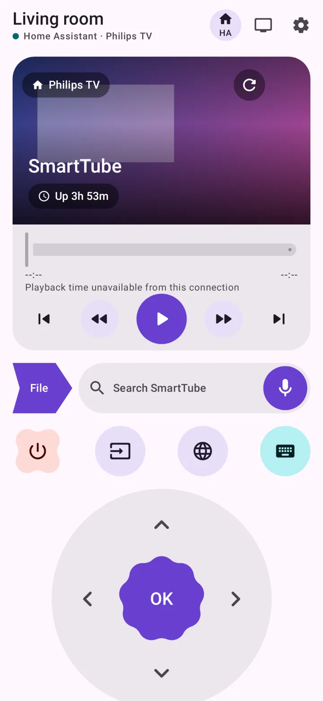</a>
  <a href="docs/screenshots/media-and-shortcuts.webp"></a>
</p>

## Features

| | |
|---|---|
| Discovery | mDNS (`_androidtvremote2._tcp`) lists TVs on the Wi-Fi, or add one by IP |
| Remote | D-pad with hold-to-repeat, OK/Back/Home with long press, power, input, menu, captions, settings, volume and channel rockers, media keys |
| Keyboard | Bottom sheet; text is sent as you type |
| Live status | Volume, mute, current app and standby (Direct); a 16:9 tile with a TV screenshot, app name and uptime (Home Assistant) |
| Macro actions | Add, rename, edit and delete any number of key sequences; defaults: **Captions** (`DOWN RIGHT*4 OK BACK`) and **1.5× speed** (`S`) |
| Quick launch | YouTube, Web Video Caster, AirReceiver, VLC |
| File streaming | Arrow-shaped File button opens the file picker; share/Open with accepts media containers, audio and photos, including generic file-manager MIME types and multiple files with a file choice |
| AirPlay | Default Play on TV destination for phone files and http(s)/HLS/DASH links (also via Open with); AirPlay card with seek, play/pause, ±10 s, stop and subtitles (track, delay, .srt/.vtt from the phone or a link) |
| IR Power (Home Assistant) | Runs your IR power script or button; set its entity in Settings → Home Assistant |
| Phone | Volume keys control the TV, haptics, dynamic colour, light/dark |

## Screenshots

Rendered from the v2.0 app UI with sample TV and media data. Select an image to view it at full size. The system file picker, speech window and software keyboard depend on the phone.

### TV setup

| Your TVs | Add by IP | Pairing |
| --- | --- | --- |
| <a href="docs/screenshots/tv-picker.webp"></a> | <a href="docs/screenshots/add-tv.webp">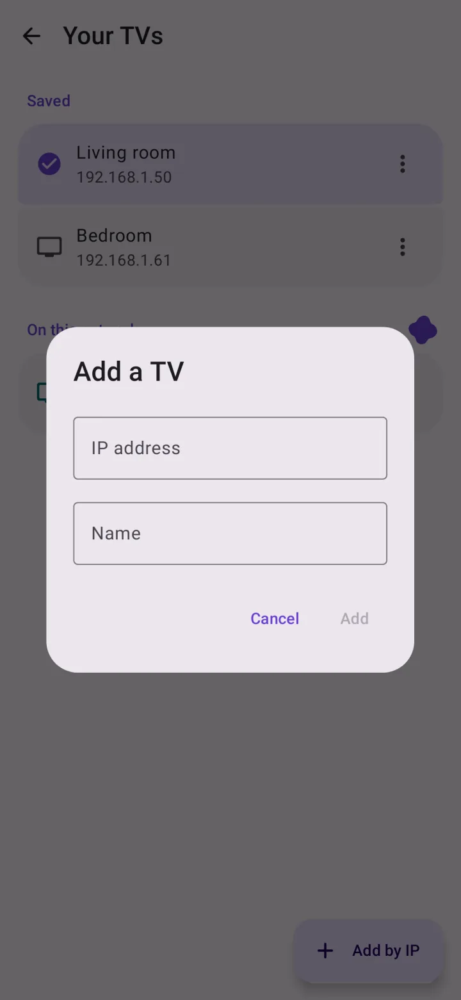</a> | <a href="docs/screenshots/pairing.webp">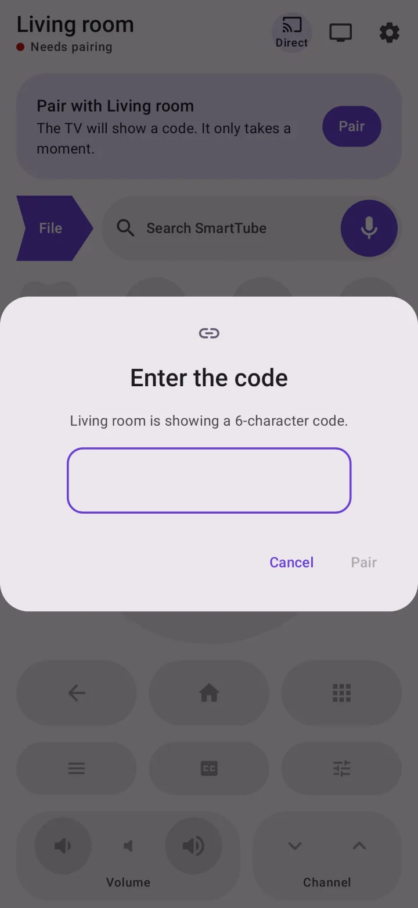</a> |


### Search, typing and macros

| SmartTube search | Keyboard panel | Macro editor |
| --- | --- | --- |
| <a href="docs/screenshots/voice-search.webp">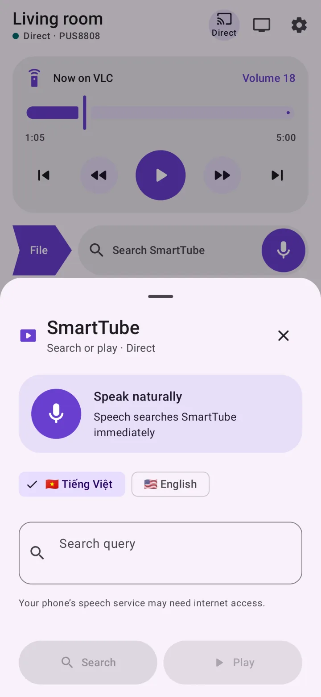</a> | <a href="docs/screenshots/keyboard.webp">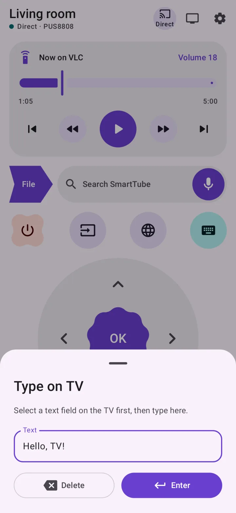</a> | <a href="docs/screenshots/macro-editor.webp">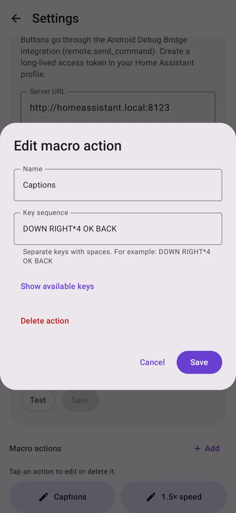</a> |


### DLNA and file sharing

| Remembered DLNA receiver | Connection menu and Disconnect |
| --- | --- |
| <a href="docs/screenshots/dlna-session.webp">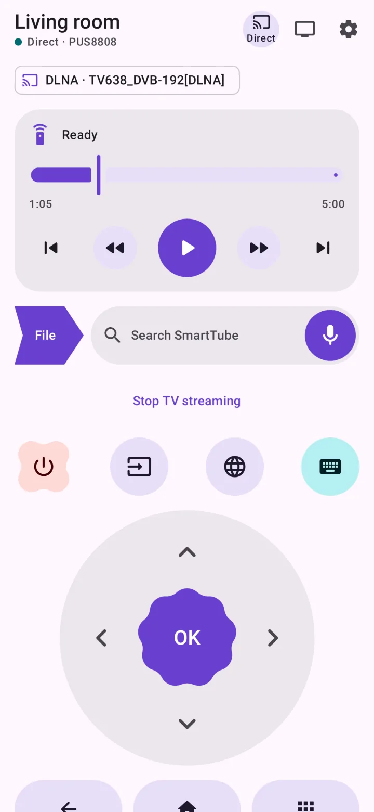</a> | <a href="docs/screenshots/dlna-menu.webp">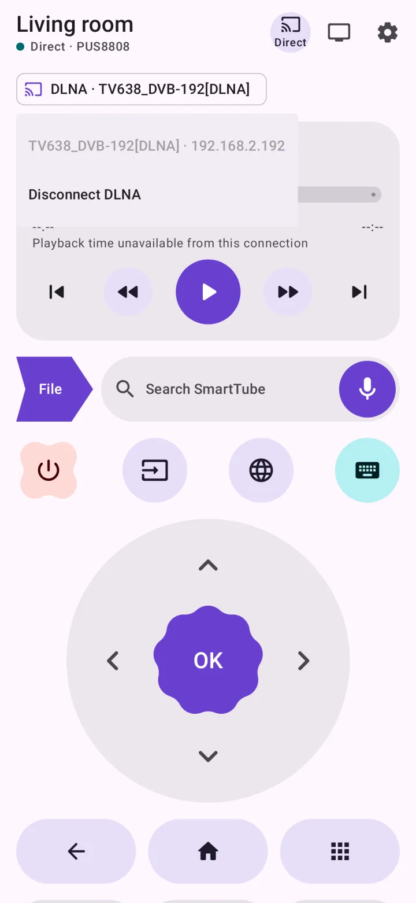</a> |

| AirReceiver / DLNA sharing | VLC sharing |
| --- | --- |
| <a href="docs/screenshots/share-dlna.webp">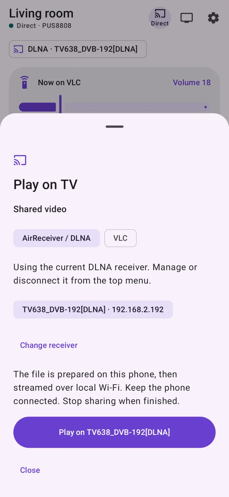</a> | <a href="docs/screenshots/share-vlc.webp">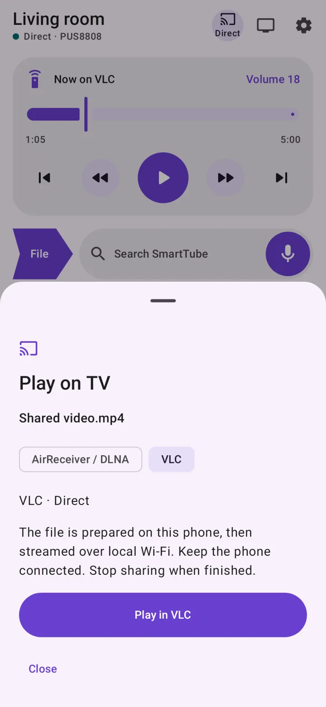</a> |


### Settings

| Home Assistant settings | Phone controls and pairing settings | Settings in dark mode |
| --- | --- | --- |
| <a href="docs/screenshots/settings.webp">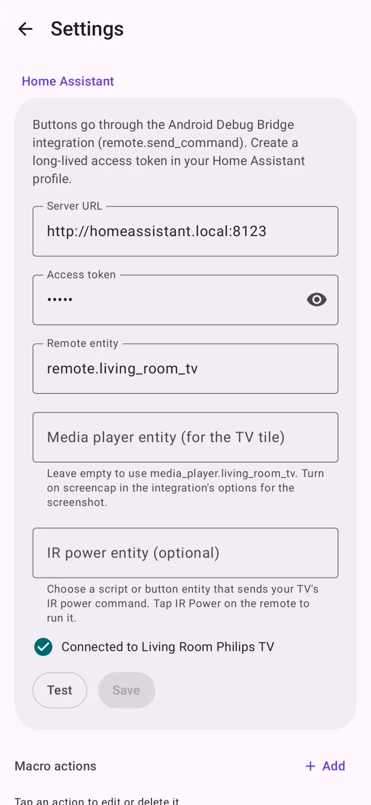</a> | <a href="docs/screenshots/settings-controls.webp">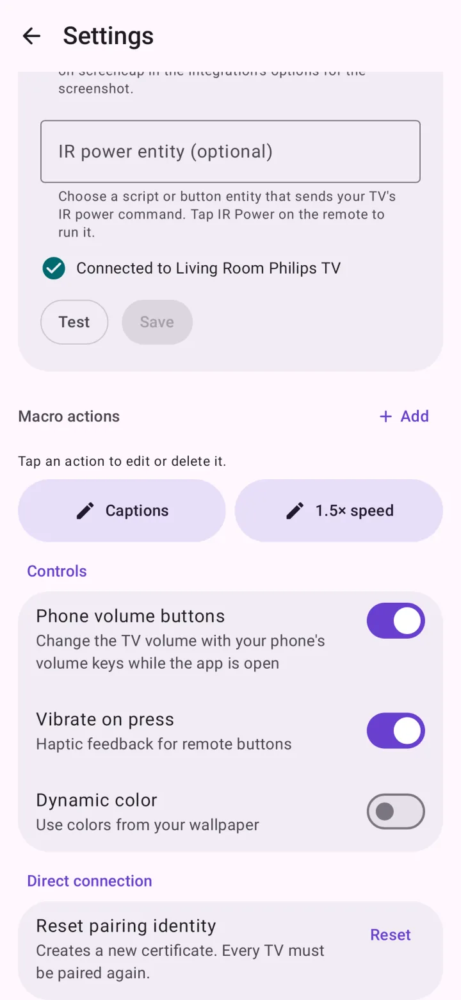</a> | <a href="docs/screenshots/settings-dark.webp">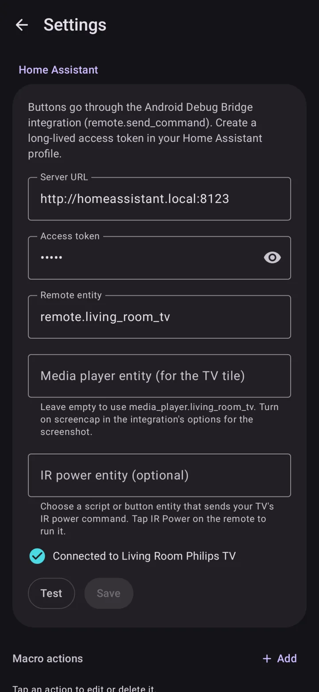</a> |

<details>
<summary>More previews: dark mode, compact text layout and pairing setup</summary>

| Dark remote | Dark SmartTube search | Dark DLNA sharing |
| --- | --- | --- |
| <a href="docs/screenshots/remote-dark.webp">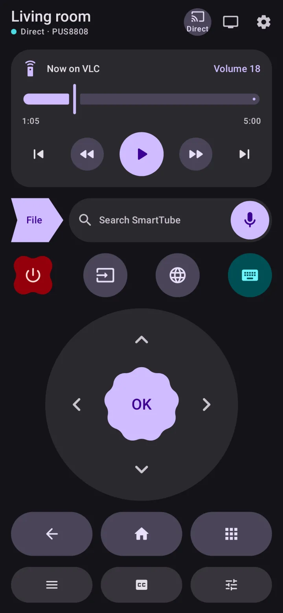</a> | <a href="docs/screenshots/voice-search-dark.webp">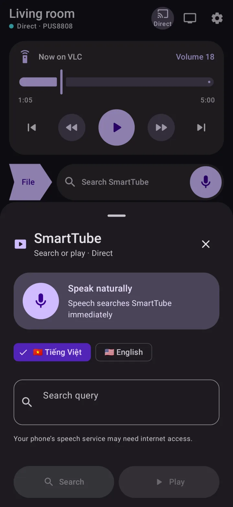</a> | <a href="docs/screenshots/share-dlna-dark.webp">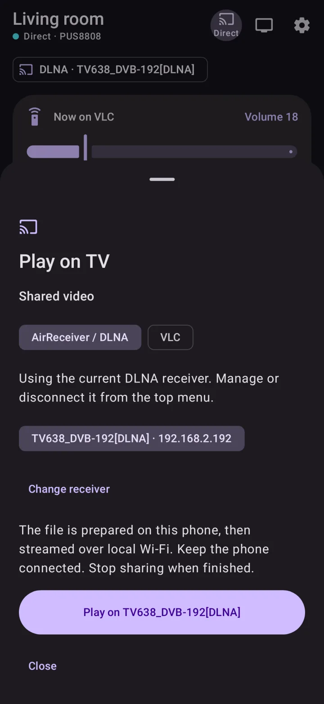</a> |

| Pairing required | Compact search with larger text |
| --- | --- |
| <a href="docs/screenshots/remote-pairing-needed.webp">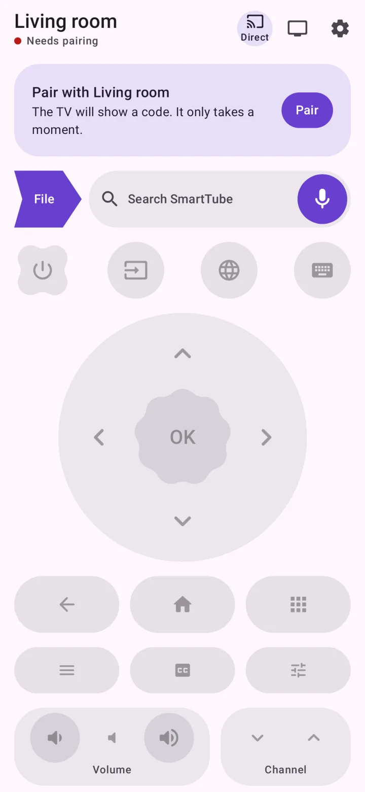</a> | <a href="docs/screenshots/voice-search-compact.webp">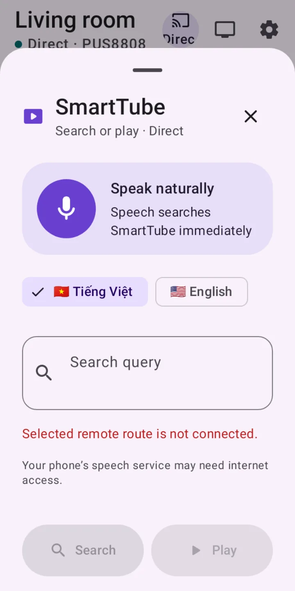</a> |

</details>

## Install

[Download Rich TV Remote 2.1 — signed ARM64 APK](https://github.com/tecix/phone-tv-remote/releases/download/v2.1/rich-tv-remote-v2.1-arm64-v8a.apk) · [Release notes and checksum](https://github.com/tecix/phone-tv-remote/releases/tag/v2.1)

Open the APK on the phone and allow installation from your browser or file manager when asked.
Requires Android 8.0+ on a 64-bit ARM phone (arm64-v8a). Install over the previous release to retain settings and TV pairing.

## Build

```sh
export JAVA_HOME=~/Android/jdk17
./gradlew installDebug          # build and install on the connected phone
./gradlew testDebugUnitTest     # protocol, macro and screenshot tests
./gradlew assembleRelease       # arm64-v8a, signed if keystore.properties exists
```

To refresh the screenshot gallery (requires `cwebp` from the WebP tools):

```sh
./gradlew testDebugUnitTest --tests 'io.github.tecix.richtvremote.*ScreenshotTest'
python3 scripts/update-screenshots.py
```

minSdk 26 · targetSdk 36 · compileSdk 37. Details in [SUMMARY.md](SUMMARY.md), progress in [STATUS.md](STATUS.md).

## Related

- [gnome-tv-remote](https://github.com/tecix/gnome-tv-remote): the GNOME desktop version; the Direct protocol code here is ported from it.
- [tv-hack](https://github.com/tecix/tv-hack): the TV-side work (launcher, TinyTV Receiver) this remote was built for.

## License

GPL-3.0-or-later, the same as gnome-tv-remote, which the protocol code is ported from.


### Voice search, playback timeline and sharing

- The main microphone and the search panel's microphone send recognized speech directly as a SmartTube **Search**, including phrases starting with “play/open”. Manual **Search** and **Play** keep their respective behavior. Rejected/disconnected requests retain the query for retry; reconnecting alone never sends it. The old Assistant key uses a browser globe icon and label.
- The labeled top-bar icon shows the selected Direct/HA route. The playback timeline is separate from the volume number.
- Real playback position and seeking use the optional **TinyTV Receiver 1.13** media extension. Enable **TinyTV media controls** in the TV's notification-access settings using the phone's **Enable playback access on TV** action. Only metadata/seek actions exposed by SmartTube, VLC, or Web Video Caster are available; live or non-seekable streams stay disabled. Stock Remote v2 has no timeline API.
- The TinyTV extension uses fields 9000/9001 on the existing paired TLS connection, without changing pairing or standard packets. Home Assistant uses its authenticated ADB route and a receiver broadcast protected by Android's `DUMP` permission. Native HA media entities with duration/position/seek support also work.
- Use **File** beside the SmartTube search bar to pick a file, or share/Open with from another app. Audio, video containers and photos are supported; when sharing multiple files, choose which one to play in the panel. Generic and vendor MIME types are resolved using the provider and filename. Documents/archives with known non-media types are rejected; the receiver still determines which media codecs it can play.
- The selected DLNA receiver is kept for the app session and shown beneath the top bar. Tap its name for **Disconnect DLNA**. Sharing another file reuses it without discovery or relaunching AirReceiver; **Change receiver** refreshes explicitly. An unreachable endpoint triggers one rediscovery/retry.
- **Stop TV streaming** on the main screen and **Stop streaming** in the notification use the same operation: cancel pending work, stop TV playback, close the phone server, remove the temporary file and release locks. Stop keeps the DLNA receiver selected; Disconnect clears the selection and stops active DLNA streaming. Stop errors remain visible for retry.
- Choose **AirReceiver / DLNA**, select the TV's discovered renderer, then **Play on [receiver]**. The selected Direct/HA route requests AirReceiver startup before discovery and retries while it starts. Direct uses the existing paired TinyTV AppLink helper; no new TV helper install is required. Enable DLNA in AirReceiver once: launching the app uses its saved settings. If no remote route is connected, open AirReceiver manually; actual DLNA streaming/discovery works independently. **VLC** remains available through the remote route for audio/video. For Google Drive, share the **actual file** with **Send a copy/Open with**; private Drive webpage links cannot be opened as authenticated media URLs on the TV.
- While a DLNA/VLC share is active, picking or sharing a new file automatically stops the old transfer, closes its server and removes its cache, then plays the new file on the selected destination. Rapid replacements cancel superseded preparation/commands. The first share still uses the destination panel; if a receiver is unavailable, the panel keeps the new file for retry.
- File shares are cached on the phone before serving a single secret-path URL over local Wi-Fi. VLC/DLNA can issue HEAD and byte-range requests for seeking. A connected-device foreground service and CPU/Wi-Fi locks keep the transfer active while the phone is locked. Stop from the app or notification; transfers expire after four hours and temporary files are deleted. Phone/TV must be mutually reachable on the LAN, and sufficient phone cache space is required. Nothing is uploaded to a cloud service. AirReceiver plays the original file without transcoding; codec support and available Wi-Fi bandwidth still determine smoothness.
- Receiver source changes are also captured in `receiver-media.patch`. The TV media API is compiled in the receiver build; its existing JVM regression suite isolates Android MediaSession behavior, which needs device verification.

The source namespace is `io.github.tecix.richtvremote`, and the Gradle project is `rich-tv-remote`. The installed Android application ID remains `io.github.tecix.textv` so signed updates preserve settings, URI grants and paired identity. A compatibility alias preserves the previous activity component.
