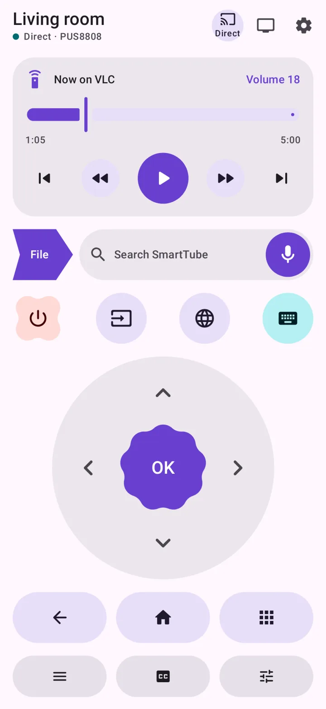
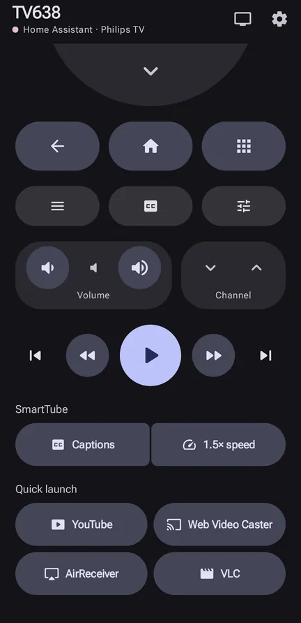
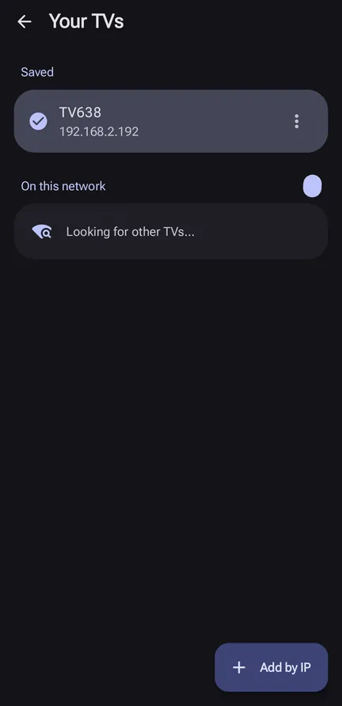

# tex-TV Remote (Android)

A phone remote for Google TV / Android TV, built with Kotlin, Jetpack Compose and
**Material 3 Expressive**. One app, two ways to reach the TV, switchable at the top of the screen:

- **Direct**: the Android TV Remote protocol v2 (the protocol of Google's own TV app). Pair once with the code on the TV.
- **Home Assistant**: `remote.send_command` through HA's Android Debug Bridge integration, for screens that only real key events can drive.

<p align="center">
  
  
  
</p>

## Features

| | |
|---|---|
| Discovery | mDNS (`_androidtvremote2._tcp`) lists TVs on the Wi-Fi, or add one by IP |
| Remote | D-pad with hold-to-repeat, OK/Back/Home with long press, power, input, menu, captions, settings, volume and channel rockers, media keys |
| Keyboard | Bottom sheet; text is sent as you type |
| Live status | Volume, mute, current app and standby (Direct); a 16:9 tile with a TV screenshot, app name and uptime (Home Assistant) |
| SmartTube | **Captions** (configurable D-pad macro) and **1.5× speed** |
| Quick launch | YouTube, Web Video Caster, AirReceiver, VLC |
| Phone | Volume keys control the TV, haptics, dynamic colour, light/dark |

## Install

Download the APK from the [latest release](https://github.com/tecix/phone-tv-remote/releases/latest) and open it on the phone
(allow installing from your browser or file manager when asked). Needs Android 8.0+ on a 64-bit ARM phone (arm64-v8a).

## Build

```sh
export JAVA_HOME=~/Android/jdk17
./gradlew installDebug          # build and install on the connected phone
./gradlew testDebugUnitTest     # protocol, macro and screenshot tests
./gradlew assembleRelease       # arm64-v8a, signed if keystore.properties exists
```

minSdk 26 · targetSdk 36 · compileSdk 37. Details in [SUMMARY.md](SUMMARY.md), progress in [STATUS.md](STATUS.md).

## Related

- [gnome-tv-remote](https://github.com/tecix/gnome-tv-remote): the GNOME desktop version; the Direct protocol code here is ported from it.
- [tv-hack](https://github.com/tecix/tv-hack): the TV-side work (launcher, TinyTV Receiver) this remote was built for.

## License

GPL-3.0-or-later, the same as gnome-tv-remote, which the protocol code is ported from.
